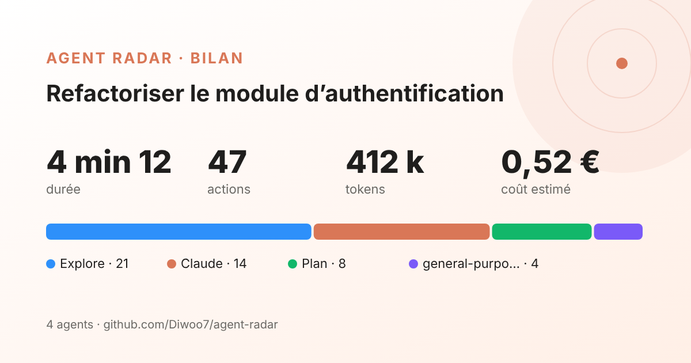

# Agent Radar

<p align="center"></p>

See what Claude does behind the scenes, live. Agent Radar is a mod that docks a light, animated pane beside the chat:

- **Which subagent is working**: every agent (Claude, Explore, Plan, general-purpose, your own agents) gets its own color and a pulsing avatar while it works.
- **Who launched whom**: agents are drawn as a tree, each subagent under the agent that spawned it. **Voir son fil** opens that agent's own transcript.
- **What it does, in plain words**: "Lit le fichier auth.ts", "Cherche « login » dans le code", "Lance : run the tests".
- **Progress**: a moving progress bar tied to Claude's own task list, plus a live activity feed.
- **Consumption**: tokens and an estimated cost in € per agent, updated after every model request.
- **Memory and quota**: how full the conversation's context is, your plan's 5-hour and 7-day quota, and the session's real cost as Claude counts it.
- **Shareable recap**: when a task ends, a card with its duration, actions, tokens, cost and agents. **Copier le texte** copies a ready-made post; **Exporter en image** has Claude send you the card as a 1200×630 PNG for LinkedIn or X.

<p align="center"></p>

Everything comes from Claude's official mod hooks (turns, model requests, tool calls, usage measurements). No screen scraping, no injected code.

## Install

At the prompt of a Claude Code terminal session:

```
/plugin install agent-radar --marketplace Diwoo7/agent-radar
```

From a shell:

```
claude plugin install agent-radar --marketplace Diwoo7/agent-radar
```

In the desktop app: click + next to the prompt box, then Plugins, Add marketplace with `Diwoo7/agent-radar`, then Add plugin.

## Use

The pane opens by itself the first time Claude starts working in a session, and stays closed if you close it. Type `/radar` to bring it back. When a task took more than 20 seconds, a toast and a short chime tell you it is done. The **Remettre à zéro** button clears the counters.

## Notes

- The per-agent € figures are estimates from Anthropic's public per-token prices and a fixed USD→EUR rate (`EUR_PER_USD` in `hooks/lib.ts`). On a Pro/Max subscription you are not billed per token: read them as "what this would cost on the API". The quota gauges are what matters on a subscription.
- The chime plays only where the device running the session can play sound; the toast always shows.
- On the terminal the pane draws a text version (no SVG animations there).
