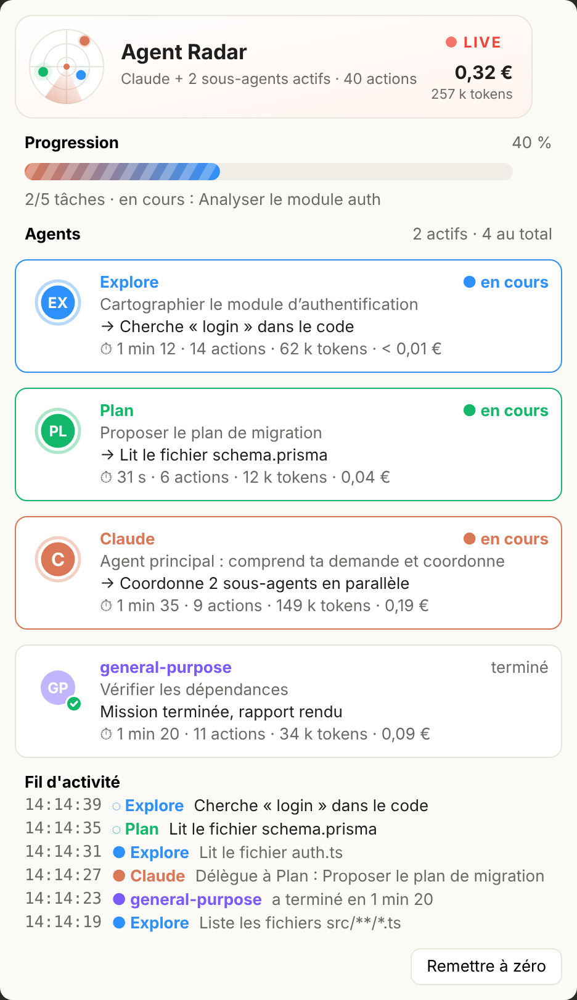

# Agent Radar

<p align="center"></p>

See what Claude Code does behind the scenes, live. Agent Radar is a mod that docks a light, animated pane beside the chat:

- **Which subagent is working**: every agent (Claude, Explore, Plan, general-purpose, your own agents) gets its own color and a pulsing avatar while it works.
- **What it does, in plain words**: "Lit le fichier auth.ts", "Cherche « login » dans le code", "Lance : run the tests".
- **Progress**: a moving progress bar tied to Claude's own task list, plus a live activity feed.
- **Consumption**: tokens and an estimated cost in € per agent and for the session, updated after every model request.

Everything comes from Claude Code's official mod hooks (turns, model requests, tool calls). No screen scraping, no injected code, and no data leaves your computer.

## Install

At the prompt of a Claude Code terminal session:

```
/plugin install agent-radar --marketplace Diwoo7/agent-radar
```

From a shell:

```
claude plugin install agent-radar --marketplace Diwoo7/agent-radar
```

In the desktop app: click + next to the prompt box, then Plugins, Add marketplace with `Diwoo7/agent-radar`, then Add plugin.

## Use

The pane opens by itself when a session starts. Closed it? Type `/radar`. The **Remettre à zéro** button clears the counters.

## Notes

- The € figure is an estimate from Anthropic's public per-token prices and a fixed USD→EUR rate (`EUR_PER_USD` in `hooks/lib.ts`). On a Pro/Max subscription you are not billed per token: read it as "what this would cost on the API".
- On the terminal the pane draws a text version (no SVG animations there).
